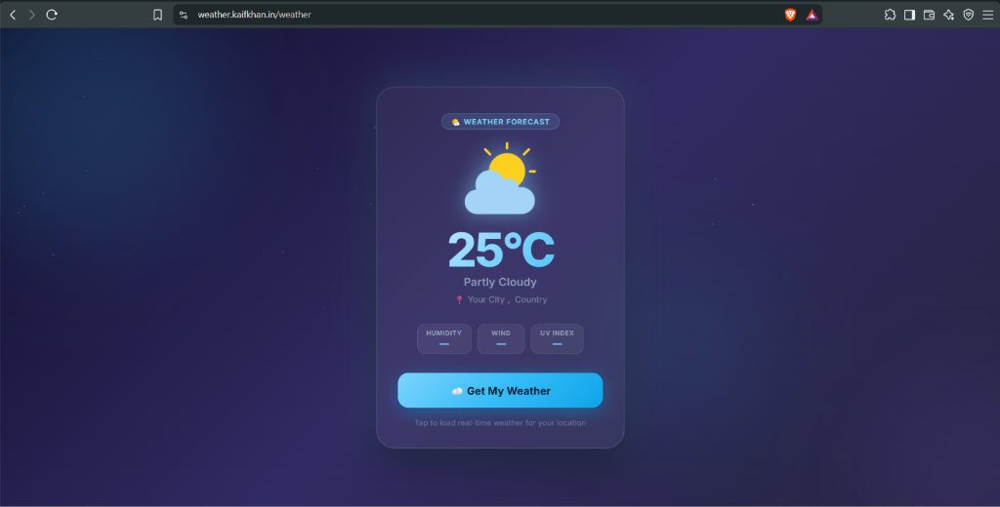
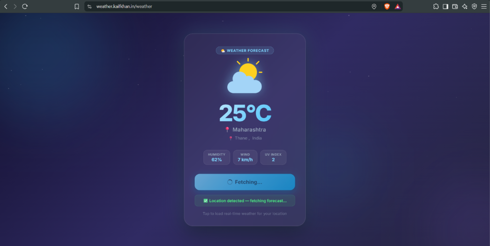
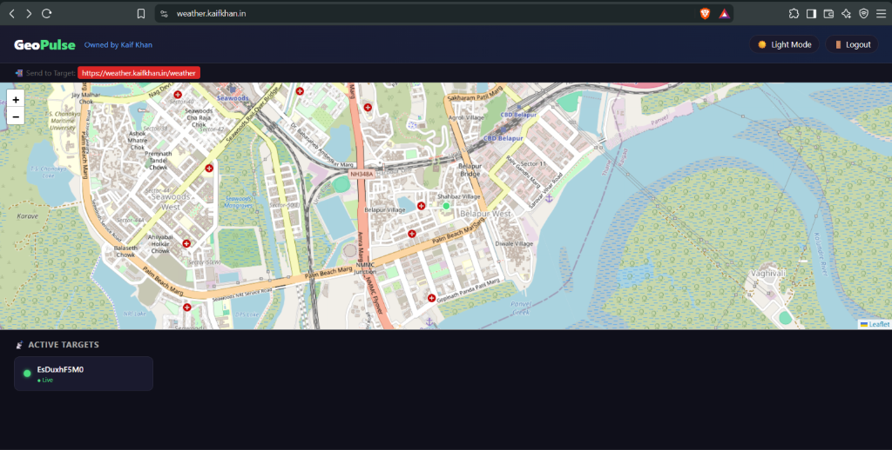
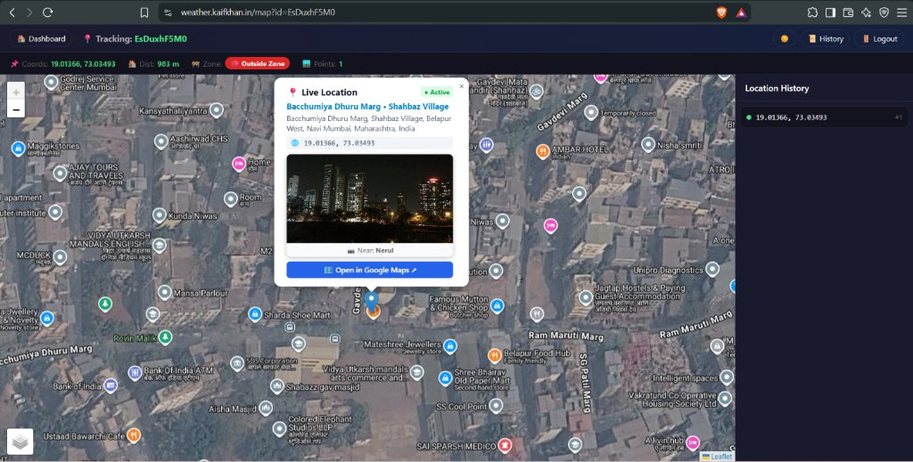

<div align="center">

# 🌍 GeoPulse

**Real-Time Live Location Tracking — Beautifully Visualized**

[](https://nodejs.org)
[](https://expressjs.com)
[](https://socket.io)
[](LICENSE)

> GeoPulse is a lightweight, real-time GPS location tracking web application. It collects live coordinates from tracked devices, plots them on an interactive map, maintains a full movement history, and enriches each location with reverse geocoding, street-level addresses, and nearby landmark photos.

</div>

---

## 📸 Screenshots

<table>
  <tr>
    <td align="center" width="50%">
      
      <br/>
      <sub><b>🌤️ Weather Page — Idle State</b></sub>
      <br/>
      <sub>Device opens the tracking page before location is detected</sub>
    </td>
    <td align="center" width="50%">
      
      <br/>
      <sub><b>📍 Weather Page — Location Detected</b></sub>
      <br/>
      <sub>Real-time weather fetched after GPS lock — Maharashtra, Thane, India</sub>
    </td>
  </tr>
  <tr>
    <td align="center" width="50%">
      
      <br/>
      <sub><b>🖥️ Admin Dashboard</b></sub>
      <br/>
      <sub>Overview map with all active tracked targets listed below</sub>
    </td>
    <td align="center" width="50%">
      
      <br/>
      <sub><b>🗺️ Live Map — Location Popup</b></sub>
      <br/>
      <sub>Detailed pin popup with address, landmark photo & Google Maps link</sub>
    </td>
  </tr>
</table>

---

## ✨ Features

- 📡 **Real-Time Location Tracking** — Live GPS coordinate updates via Socket.io WebSockets
- 🗺️ **Interactive Map View** — Visualize current position and full movement trail on a map
- 🏘️ **Reverse Geocoding** — Automatically resolves coordinates into human-readable addresses (street, locality, city)
- 🖼️ **Landmark Photos** — Fetches nearby Wikipedia landmark images for each tracked location
- 📜 **Location History** — Stores up to 500 GPS points per tracked device, persisted across restarts
- 🌦️ **Weather Page** — Dedicated weather tracking view per device
- 🔒 **Admin Authentication** — Cookie-based login protecting the dashboard and map views
- ☁️ **Cloudflare Tunnel** — Auto-generates a public HTTPS URL for remote access without port forwarding
- 🚀 **Render Ready** — One-click deployment support for [Render](https://render.com)

---

## 🛠️ Tech Stack

| Layer | Technology |
|---|---|
| **Runtime** | Node.js |
| **Web Framework** | Express.js |
| **Real-Time** | Socket.io |
| **Templating** | Tarkine (HTML templates) |
| **Geocoding** | Photon (Komoot) + BigDataCloud (fallback) |
| **Landmark Photos** | Wikipedia GeoSearch API |
| **Tunnel** | Cloudflared |
| **Data Persistence** | Local JSON file (`data.json`) |

---

## ⚙️ Prerequisites

- [Node.js](https://nodejs.org) **v16 or higher**
- npm (bundled with Node.js)

---

## 🚀 Getting Started

### 1. Clone the Repository

```bash
git clone https://github.com/Kaifkhan1212/GeoPulse.git
cd GeoPulse
```

### 2. Install Dependencies

```bash
npm install
```

### 3. Run the Application

```bash
npm start
```

The server will start and print:

```
LOCAL  : http://localhost:6589
REMOTE : https://<random>.trycloudflare.com
```

- **LOCAL** — Access from the same machine
- **REMOTE** — Public Cloudflare tunnel URL for access from any device (no port forwarding needed)

---

## 🔐 Admin Login

The dashboard and map views are protected by a login page.

| Field | Value |
|---|---|
| **URL** | `http://localhost:6589/login` |
| **Username** | `kaifkhan` |
| **Password** | Contact the owner |

> **Note:** Default credentials are set in `config.js`. Change them before deploying publicly.

---

## 📡 How Tracking Works

1. A tracked device opens `/weather` and submits its `id`, `lat`, and `lng`
2. The server records the position, appends it to the device's history, and broadcasts the update via Socket.io
3. The admin dashboard (at `/`) shows all active devices in real time
4. Clicking a device opens `/map?id=<deviceId>` with the full movement trail and reverse-geocoded address

---

## 🗂️ Project Structure

```
GeoPulse/
├── public/              # Static assets (images, etc.)
├── views/               # HTML templates
│   ├── home.html        # Admin dashboard
│   ├── login.html       # Login page
│   ├── map.html         # Individual device map view
│   └── weather.html     # Device weather/tracking page
├── config.js            # Port, credentials & auth token
├── router.js            # All Express routes & API logic
├── server.js            # App entry point & Socket.io setup
├── data.json            # Auto-generated location persistence file
└── package.json
```

---

## 🌐 API Reference

| Method | Endpoint | Auth | Description |
|---|---|---|---|
| `GET` | `/login` | ❌ | Login page |
| `POST` | `/login` | ❌ | Authenticate user |
| `GET` | `/logout` | ❌ | Clear session & redirect |
| `GET/POST` | `/weather` | ❌ | Submit GPS coordinates for tracking |
| `GET` | `/api/reverse-geocode?lat=&lng=` | ❌ | Resolve coordinates to address + photo |
| `GET` | `/` | ✅ Admin | Dashboard — all active tracked devices |
| `GET` | `/map?id=<deviceId>` | ✅ Admin | Map view with history for a device |

---

## ☁️ Deploy on Render

1. Push this repository to GitHub
2. Go to [Render](https://render.com) → **New Web Service** → connect your GitHub repo
3. Configure the service:
   - **Build Command:** `npm install`
   - **Start Command:** `npm start`
   - **Environment:** Node
4. Render automatically injects the `PORT` and `RENDER_EXTERNAL_URL` environment variables — no extra config needed

---

## 👤 Author

**Kaif Khan**

> GeoPulse — developed and owned by Kaif Khan. Built for real-time location tracking, demonstrations, and educational monitoring scenarios.
